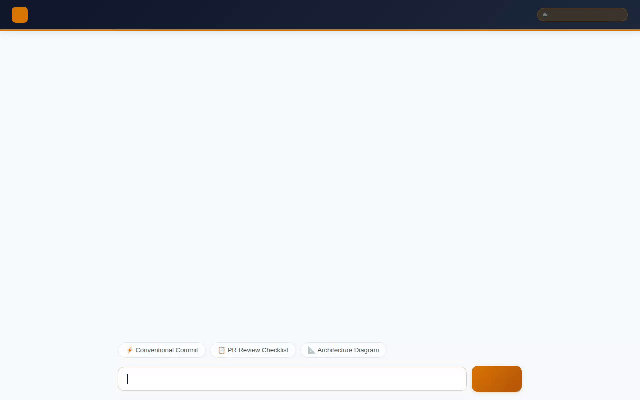

# DevCraft - AI Developer Assistant

An intelligent, context-aware AI developer assistant built with the **Google Agent Development Kit (ADK)** and deployed to **Vertex AI Agent Engine**.



---

## 🛠️ Implemented Agent Capabilities

DevCraft is designed to assist software engineers throughout the development and pull request lifecycle. Based on the code in `app/` and `agents-cli-manifest.yaml`, the following capabilities are fully implemented:

* **🧠 Long-Term Session Memory (Vertex AI Memory Bank)**:
  Uses `VertexAiMemoryBankService` to store session history and recall developer preferences, coding conventions, and architectural context across turns and sessions.
* **📋 Dev Ticket Management (Google Cloud Firestore)**:
  Directly integrated with Google Cloud Firestore (`dev_tickets` collection) to list, retrieve, create, and update developer tickets (`list_dev_tickets`, `get_dev_ticket`, `create_dev_ticket`, `update_ticket_status`).
* **🎨 Architecture Diagram & Asset Generation (Gemini + Cloud Storage)**:
  Generates system architecture diagrams, icons, and developer visual assets using `gemini-3.1-flash-lite-image`. Artifacts are saved locally and uploaded directly to a Google Cloud Storage bucket.
* **📊 Rich Display Cards (A2UI v0.8)**:
  Emits A2UI surface updates (Cards, Columns, Rows, Checklists, Dividers, Images) via `a2ui_callback` to render structured UI components natively inside the client interface.
* **💻 Python Code Execution Sandbox**:
  Executes Python code dynamically in an isolated `AgentEngineSandboxCodeExecutor` cloud container environment.
* **🐙 Git Repository Inspection**:
  Runs `get_git_status_and_diff` via the git CLI to inspect workspace status and uncommitted changes for conventional commit formatting and PR reviews.
* **🔍 GitHub Repository Search**:
  Searches public GitHub repositories (`search_github_repositories`) for open-source code examples, dependencies, and reference implementations.
* **🗺️ Geocoding & Places Search**:
  Geocodes addresses (`geocode_address`) and locates nearby places (`find_nearby_places`) using the Google Maps and Places APIs.

---

## 🏗️ Architecture & Cloud Infrastructure

* **Framework**: Google Agent Development Kit (ADK) v1.1.0 (A2A Protocol)
* **Model**: Gemini 2.5 Flash / Gemini 3.1 Flash Lite Image
* **Deployment Target**: Vertex AI Agent Engine (`us-east1`)
* **Database**: Google Cloud Firestore (`dev_tickets`)
* **Storage**: Google Cloud Storage (`gs://devcraft-media-...`)
* **Memory Service**: Vertex AI Memory Bank
* **Frontend Proxy**: FastAPI talking A2A protocol + Vanilla HTML/CSS client with built-in A2UI renderer

---

## 🚀 Local Setup & Running Instructions

### Prerequisites
* Python 3.11+
* Google Cloud SDK (`gcloud`) configured with project permissions (`roles/aiplatform.user`, `roles/datastore.user`, `roles/storage.objectAdmin`)

### 1. Run the Local ADK Playground
To test the agent locally with Memory Bank support:

```bash
uv run adk web . --port 8000 --reload_agents --memory_service_uri=agentengine://<YOUR_MEMORY_BANK_ID>
```

### 2. Run the Custom FastAPI Frontend Proxy
To run the custom frontend proxy locally connected to your deployed Agent Engine instance:

```bash
cd frontend
pip install -r requirements.txt

export AGENT_ENGINE_RESOURCE_NAME="projects/<PROJECT_ID>/locations/us-east1/reasoningEngines/<REASONING_ENGINE_ID>"
export AGENT_DIRECTORY="app"
export PORT=8080

python main.py
```

---

## 🚢 Cloud Run Frontend Deployment

Deploy the FastAPI proxy frontend to Google Cloud Run using `gcloud`:

```bash
gcloud run deploy devcraft-frontend \
  --source . \
  --region us-east1 \
  --allow-unauthenticated \
  --set-env-vars="AGENT_ENGINE_RESOURCE_NAME=$AGENT_ENGINE_RESOURCE_NAME,AGENT_DIRECTORY=$AGENT_DIRECTORY"
```
